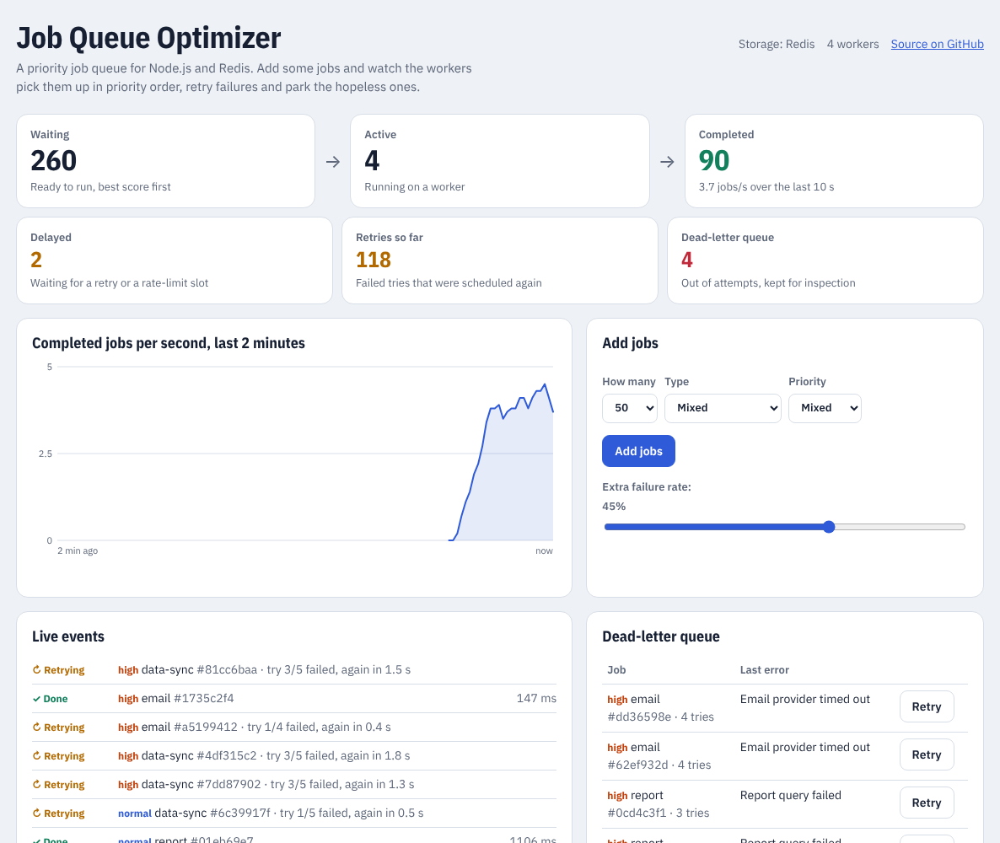
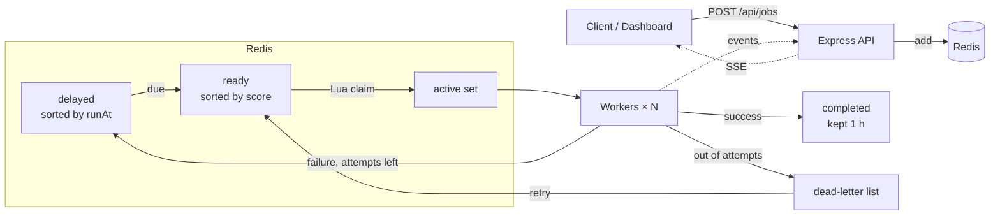

# Job Queue Optimizer

A priority job queue for Node.js backed by Redis, with a live dashboard.

Jobs are picked up in priority order, but low-priority jobs gain ground the longer they wait, so they are never starved. Failed jobs retry with exponential backoff and jitter, and jobs that run out of attempts land in a dead-letter queue where you can inspect and retry them. Per-type rate limits, atomic claims across processes and crash recovery are built in.

**Live demo:** https://job-queue-optimizer.onrender.com (free tier, so the first load can take ~30 s while it wakes up)



## Features

| Feature | How it works |
|---|---|
| **Priority with aging** | Each ready job gets a score: `priority level × 15 s + time it became ready`. Lowest score runs first. A `low` job that has waited 30 s longer than a fresh `high` job ties with it, so nothing waits forever. |
| **Atomic claims** | A single Redis Lua script promotes due delayed jobs and pops the best ready job (`ZPOPMIN`). Any number of workers or processes can share one queue and a job is never handed out twice. |
| **Retries with backoff** | Delay = `min(cap, base × 2^(attempt−1))` with "full jitter", so a burst of failures doesn't retry in lockstep and hammer a struggling service. |
| **Dead-letter queue** | After the last attempt the job is parked with its error. One API call (or one click) gives it a fresh set of attempts. |
| **Rate limits** | A token bucket per job type (e.g. 8 emails/s). A throttled job is deferred without using up an attempt. |
| **Timeouts** | A job that runs past its timeout counts as a failed attempt instead of blocking a worker forever. |
| **Crash recovery** | On start-up, jobs that were `active` when the last process died go back into the queue, and the interrupted try isn't counted. |
| **Graceful shutdown** | On `SIGTERM` the workers finish the jobs they hold before the process exits. |
| **Backpressure** | The queue refuses new jobs past a backlog limit (5,000 by default) instead of running out of memory. |
| **Live dashboard** | Server-Sent Events stream every job event plus a stats snapshot each second. |

## Architecture



The storage layer sits behind one small interface (`add`, `claim`, `complete`, `fail`, `defer`, `retryDead`, `recoverActive`, `counts`, ...). There are two implementations:

- `RedisStore`: sorted sets, a Lua claim script and `MULTI` transactions. Used when `REDIS_URL` is set.
- `MemoryStore`: two binary min-heaps (ready by score, delayed by time), with no dependencies. Used for local runs without Redis.

The same behaviour tests run against both.

## Run it locally

Needs Node.js 20 or newer.

```bash
npm install
npm start                 # in-memory store, open http://localhost:3000
```

With Redis:

```bash
docker run -d -p 6379:6379 redis:7
REDIS_URL=redis://localhost:6379 npm start
```

Run the tests (they also start a throwaway `redis-server` if one is installed):

```bash
npm test
```

| Variable | Default | Meaning |
|---|---|---|
| `PORT` | `3000` | HTTP port |
| `REDIS_URL` | not set | Use Redis; without it, jobs live in memory |
| `CONCURRENCY` | `4` | Number of worker loops |
| `MAX_BACKLOG` | `5000` | Waiting + delayed jobs allowed before new ones are refused |

## API

| Method | Path | Description |
|---|---|---|
| `GET` | `/health` | Status and which store is in use |
| `GET` | `/api/types` | Job types, their attempts and rate limits |
| `GET` | `/api/stats` | Counts per state, throughput, retries, dead |
| `POST` | `/api/jobs` | Add a job: `{ "type": "email", "priority": "high", "payload": {}, "delayMs": 0 }` |
| `POST` | `/api/jobs/bulk` | Add up to 500 jobs: `{ "count": 50, "type"?: "...", "priority"?: "..." }` |
| `GET` | `/api/jobs?list=recent\|dead` | Recently finished jobs, or the dead-letter queue |
| `GET` | `/api/jobs/:id` | One job with its state, attempts, result or last error |
| `POST` | `/api/jobs/:id/retry` | Send a dead job back to the queue |
| `POST` | `/api/chaos` | Demo only: `{ "extraFailure": 0.3 }` raises the failure rate |
| `GET` | `/api/events` | Server-Sent Events: `job` and `stats` |

Example:

```bash
curl -X POST localhost:3000/api/jobs \
  -H 'Content-Type: application/json' \
  -d '{"type":"report","priority":"high"}'
```

## Adding your own job type

Job types live in `src/handlers.js`:

```js
const jobTypes = {
  "resize-image": {
    label: "Resize image",
    handler: async (payload) => {
      // do the work; throw to fail this attempt
      return { url: "..." };
    },
    maxAttempts: 4,
    rateLimit: { perSecond: 10, capacity: 10 }, // optional
  },
};
```

The demo types (`email`, `report`, `data-sync`) simulate work with random durations and failure rates.

## Deploy

`render.yaml` is a Render Blueprint: a free web service plus a free Key Value (Redis-compatible) instance on the private network. Click **New → Blueprint** in Render and pick this repo.

## Project layout

```
src/
  server.js          start-up, store choice, crash recovery, graceful shutdown
  app.js             Express routes and the SSE stream
  queue.js           worker loops, timeouts, retries, backoff, rate limiting
  scoring.js         priority + aging score
  heap.js            binary min-heap
  rateLimiter.js     token bucket
  handlers.js        job types
  stores/
    memoryStore.js
    redisStore.js    Lua claim script
public/index.html    dashboard (no build step)
test/                node:test suites, run against both stores
```

## License

MIT © Rahul Singh
